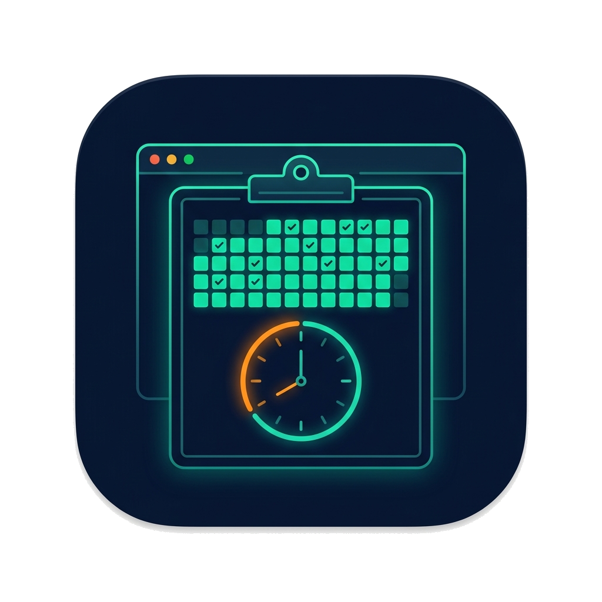

<p align="center">
  
</p>

# workedTask

**Daily GitHub work status reports with shift policy, AI summaries, and strict factual validation.**

_Connect your GitHub activity once. Get structured office-ready status reports every day._

---

[The Problem](#the-problem) · [The Solution](#the-solution) · [Quick Start](#quick-start) · [CLI Reference](#cli-reference) · [Configuration](#configuration) · [Programmatic API](#programmatic-api) · [AI Summaries](#ai-summaries) · [Validation](#validation) · [Architecture](#architecture)

---

## The Problem

Filling out a daily status report requires collecting scattered information — commits across multiple repositories, PR reviews, issue comments, merge times — and formatting it correctly for your office format.

### The daily status problem

```text
Without workedTask

Developer
   ├── Open GitHub and check each repo
   ├── Find today's commits, PRs, and reviews
   ├── Remember what counts as overtime
   ├── Format the report manually
   └── Do this again tomorrow
```

Developers who work across multiple repositories with strict shift policies need an accurate, reproducible record of what happened and when — not a summary that could be challenged later.

---

## The Solution

`workedTask` is a **report consumer of ghToolkit**, not a GitHub API client. All GitHub data collection is delegated to `ghToolkit.collect_daily_activity`. The tool applies your configured shift policy, groups activity by repository and PR, marks overtime, and formats a structured office status report.

### How a report is built

```text
GitHub API
     |
     v
ghToolkit (activity collection + association)
     |
     v
workedTask ReportService
     ├── Shift policy (timezone, start, end, day cutoff)
     ├── PR grouping (commits, reviews, comments, merges)
     ├── Overtime marker: "(The task is done in extra time)"
     ├── Manual non-GitHub tasks (JSON file)
     └── Optional: Gemini AI per-PR summaries
          |
          v
     Office status report  →  stdout / file
          |
          v
     StrictFormatValidator + FactualValidator
```

### Five activity categories

| Category | Description |
| --- | --- |
| **PRs** | Authored pull requests with merge status from GitHub's `merged_by` field |
| **Reviewed PRs / Comments** | Submitted review state (`APPROVED`, `CHANGES_REQUESTED`, `COMMENTED`) with reviewer, time, and link |
| **Standalone branch commits** | Commits on branches not associated with a PR |
| **Issues** | Issue activity attributed to the configured author |
| **Manual tasks** | Non-GitHub tasks supplied through a local JSON file |

---

## Quick Start

### Prerequisites

- Python 3.11 or newer
- A GitHub token (`GITHUB_TOKEN` or `GH_TOKEN`) — or an existing `gh auth login` session
- `uv` (recommended) or `pip`

### Install

```bash
# With uv (recommended)
cd /path/to/utils
uv sync --all-packages --extra dev

# With pip + venv
python -m venv .venv
source .venv/bin/activate
pip install -e ./ghToolkit -e ./workedTask
```

For AI summaries, install the optional extra:

```bash
pip install -e './workedTask[ai]'
```

### Configure

```bash
cp .env.example .env
# Edit .env and set your GEMINI_API_KEY if using AI
```

Create a configuration file:

```json
{
  "repositories": ["owner/repo-one", "owner/repo-two"],
  "author": "your-github-login",
  "timezone": "Asia/Karachi",
  "shift_start": "11:00",
  "shift_end": "20:00",
  "day_start": "06:00"
}
```

Save it as `worked-task.json` or pass it with `--config`.

### Run

```bash
# Today's report
make today

# Specific date
worked-task 2026-10-24 --config worked-task.json

# With AI summaries
worked-task 2026-10-24 --config worked-task.json --ai --model gemini-2.5-flash-lite
```

---

## CLI Reference

```text
worked-task [date] [options]
status-report [date] [options]     # alias
python -m src [date] [options]     # direct
```

### Positional

| Argument | Description |
| --- | --- |
| `date` | Work date in `YYYY-MM-DD`; defaults to current configured reporting day |

### Options

| Flag | Description |
| --- | --- |
| `--config PATH` | JSON configuration file; or set `WORKED_TASK_CONFIG` |
| `--repo owner/repo` | Override repositories (repeat for multiple) |
| `--author LOGIN` | Override report author |
| `--alias LOGIN` | Additional author aliases (repeat for multiple) |
| `--timezone TZ` | IANA timezone name (e.g. `Asia/Karachi`) |
| `--shift-start HH:MM` | Shift start time (local) |
| `--shift-end HH:MM` | Shift end time (local) |
| `--day-start HH:MM` | Reporting-day cutoff; use `06:00` to include next-day 02:00 |
| `--workers N` | Parallel repository fetches (1–8) |
| `--manual-tasks PATH` | JSON file of non-GitHub tasks |
| `--snapshot PATH` | Replay a ghToolkit snapshot without network access |
| `--ai` | Enable Gemini AI per-PR summaries |
| `--model NAME` | Gemini model identifier; or set `GEMINI_MODEL` |
| `--ai-failure MODE` | `raise` (default) or `keep-raw` on AI error |
| `--format office` | Report format (`office` is the only supported format) |
| `--output PATH` | Write report to file (atomic replacement) |
| `--chunks-output PATH` | Write one cleaned PR per JSONL line for AI handoff |

### Make targets

```bash
make today          # Report for today
make yesterday      # Report for yesterday
make extract DATE=2026-10-24   # Report for a specific date
make test           # Run pytest suite
make lint           # Run ruff linter and format check
make format         # Auto-format code with ruff
make clean          # Clean cache and build files
```

---

## Configuration

All configuration keys can be set in a JSON file and overridden by CLI flags. Paths in the configuration file are relative to the **working directory**, not the file's location.

```json
{
  "repositories": ["owner/repo"],
  "author": "your-login",
  "author_aliases": ["alt-login"],
  "timezone": "Asia/Karachi",
  "shift_start": "11:00",
  "shift_end": "20:00",
  "day_start": "06:00",
  "workers": 2,
  "manual_tasks": "tasks.json",
  "ai": false,
  "model": "gemini-2.5-flash-lite",
  "ai_failure": "raise"
}
```

### Shift and overtime policy

The regular shift **includes** `shift_start` and **excludes** `shift_end`. Any activity before the start or at/after the end is marked as overtime:

```text
(The task is done in extra time)
```

A `day_start` of `06:00` associates activity between 06:00 on the work date and 06:00 the following calendar day with a single reporting day. A 22:00–06:00 overnight shift does not mark 02:00 as overtime if it falls within the configured window.

> **Note:** Set your actual shift times. There are no guessed defaults. Non-existent DST clock times are rejected, and ambiguous times use the first occurrence. Date-only and timezone-free manual timestamps are rejected.

### Shift Baseline (Lahore, Pakistan)

| Setting | Value |
| --- | --- |
| Timezone | `Asia/Karachi` (PKT, UTC+05:00) |
| Shift | 11:00 AM – 8:00 PM PKT |
| Overtime condition | `t < 11:00 OR t >= 20:00 PKT` |
| Mandatory overtime marker | `(The task is done in extra time)` |

### Manual tasks

Non-GitHub tasks can be supplied in a JSON file:

```json
[
  {
    "title": "Sprint planning meeting",
    "timestamp": "2026-10-24T14:30:00+05:00"
  }
]
```

---

## Programmatic API

```python
from utils import format_office_status, generate_report

report = generate_report(
    {
        "repositories": ["owner/repo"],
        "author": "your-login",
        "timezone": "Asia/Karachi",
        "shift_start": "11:00",
        "shift_end": "20:00",
        "day_start": "06:00",
    },
    "2026-10-24",
)
print(format_office_status(report))
```

### Inject a custom summarizer

```python
from utils import generate_report
from ai.summarizer import Summarizer
from report.data_classes import ReportChunk


class MySummarizer:
    def summarize(self, chunk: ReportChunk) -> str:
        return f"Summary of {chunk.pr_title}"


report = generate_report(config, "2026-10-24", summarizer=MySummarizer())
```

### Replay a snapshot

```python
from ghtoolkit import SnapshotSource
from utils import generate_report

report = generate_report(
    {**config, "snapshot": "activity-snapshot.json"},
    "2026-10-24",
)
```

---

## AI Summaries

`workedTask` does **not** select an AI provider automatically. Pass `--ai` to opt in.

```bash
worked-task 2026-10-24 --ai --model gemini-2.5-flash-lite
```

Set credentials in `.env` or your environment:

```bash
GEMINI_API_KEY=your-key
GEMINI_MODEL=gemini-2.5-flash-lite
```

### What AI adds

- **Per-PR summary:** A one-sentence description of the PR's changes, generated from the cleaned PR chunk.
- **Review feedback:** For reviewed PRs, a short `Review feedback:` line based **only** on the author's review comments. The office report also summarizes submitted review states in order and includes one PR link. Individual event times and links remain in the activity data. Generic "reviewed" notes do not become feedback claims.

> **Important:** AI review feedback lines require independent evidence review before factual validation passes. The application always keeps raw evidence and renders overtime markers itself. Reviews outside the shift stay in `Overtime:`.

### JSONL export for AI handoff

```bash
worked-task 2026-10-24 --chunks-output chunks.jsonl
```

Each line is one cleaned PR record. Use this to feed chunks to any AI pipeline.

---

## Validation

The package includes two validators for generated reports.

### StrictFormatValidator

Checks structural correctness:
- `STATUS (DD-MMM-YYYY)` header format
- Project → Conditional Sections → `->` bullets hierarchy
- No malformed section headers or bullet symbols

```python
from validator import StrictFormatValidator

result = StrictFormatValidator().validate(report_text)
print(result.passed, result.errors)
```

### FactualValidator

Links each report line to a source `DailyReport` activity snapshot:

```python
from validator import FactualValidator

result = FactualValidator().validate(report_text, daily_report)
print(result.source_consistency_percent)  # % of lines with evidence
```

`source_consistency_percent` measures whether the generated report is **reproducible from its evidence snapshot** — not a guarantee that PR titles, commit messages, or AI summaries are accurate. A separate live GitHub and code review is needed before making an external factual-accuracy claim.

> **Note:** `fact_support_percent` remains available as a legacy alias for `source_consistency_percent`.

---

## Architecture

`workedTask` enforces a strict separation: it contains **no GitHub API client** and **no shell-based GitHub data collection**. An architecture test enforces this boundary.

```text
workedTask
├── src/
│   ├── cli/           — CLI entry point (worked-task / status-report)
│   ├── report/        — ReportService, DailyReport, ReportChunk data classes
│   ├── extractors/    — DailyActivityExtractor (delegates to ghToolkit)
│   ├── ai/            — GeminiSummarizer, Summarizer protocol
│   ├── validator/     — StrictFormatValidator, FactualValidator
│   ├── utils/         — format_office_status, generate_report, render
│   ├── config/        — Configuration loading and schedule parsing
│   └── constants.py   — Active free Gemini model registry
├── tests/             — pytest suite (architecture, CLI, AI, validators)
├── Makefile           — Developer shortcuts
└── pyproject.toml     — Package metadata (name: status-reporter, v0.2.0)
```

### Merge attribution

- A merge is attributed to the account in GitHub's `merged_by` field. A merge commit author is **not** used as proof of who merged.
- Merges by the report author appear as dated PR activity even without a commit or comment that day.
- When GitHub merge metadata is unavailable, the report says so instead of treating the PR as unmerged.
- Merge status reflects GitHub at the time the report was generated; the merge timestamp remains explicit.

### Review attribution

- A submitted review prints its exact GitHub state (`APPROVED`, `CHANGES_REQUESTED`, or `COMMENTED`), reviewer, time, and review link when available.
- PR comments are labeled as comments and **do not imply approval**.
- An `APPROVED` review records the submitted review state and time; it does not prove that the reviewer approved commits pushed to the PR after the review.

### Authentication

For live reports, credentials come from `GITHUB_TOKEN` or `GH_TOKEN` when set; otherwise the program runs `gh auth token` through a subprocess to use an existing GitHub CLI login. Run `gh auth login` once beforehand if needed. Snapshot reports and injected activity sources do not require GitHub credentials.

---

## Related

- **[ghToolkit](../ghToolkit)** — The GitHub activity collection layer used by this package
- **[Aevora](https://github.com/Volcann/Aevora)** — AI chat platform that exposes `report_status` as a Celery tool via this package
- **[lazy-reviewer](../lazy-reviewer)** — PR review utility companion

---

<p align="center">
  <sub>workedTask · status-reporter v0.2.0 · Python 3.11+</sub>
</p>
